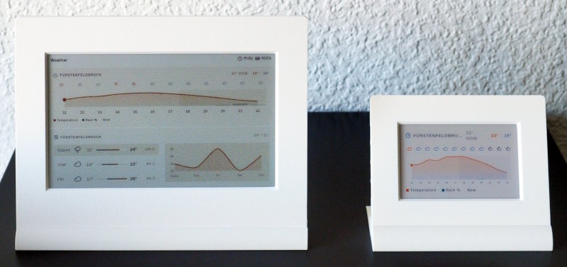
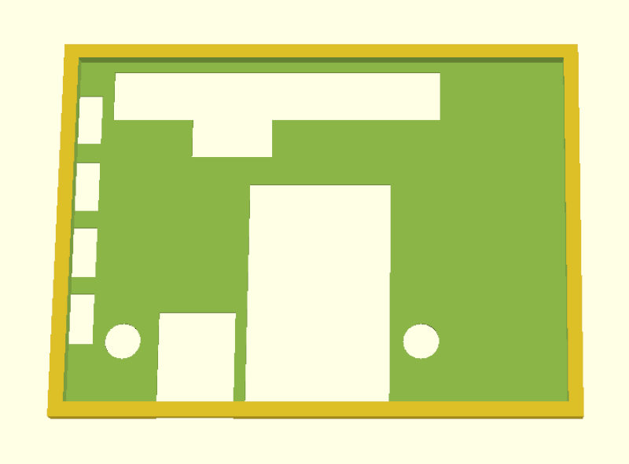
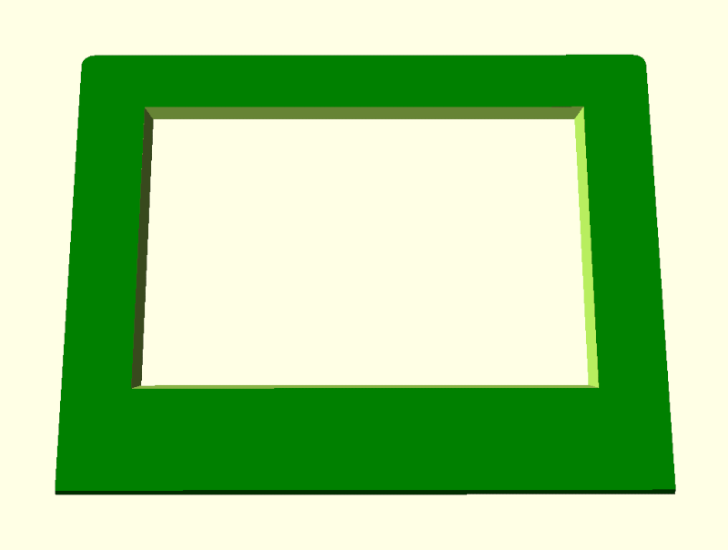
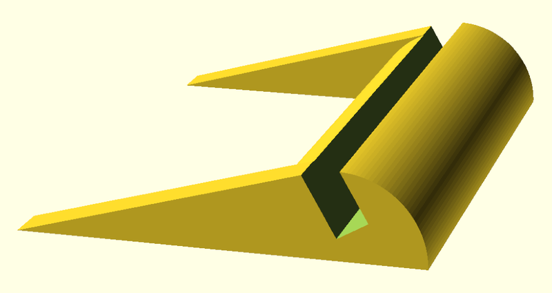
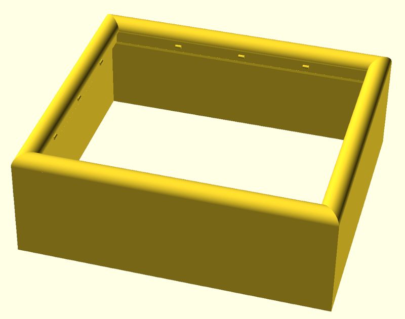
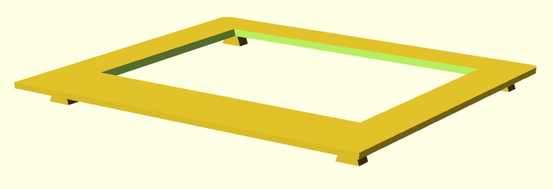
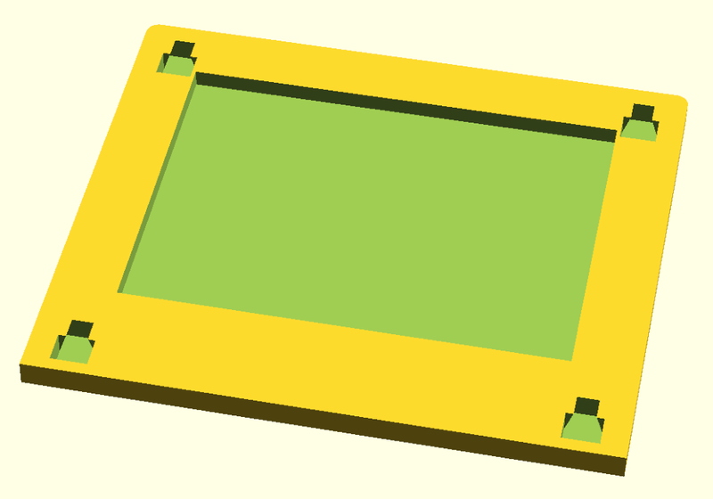
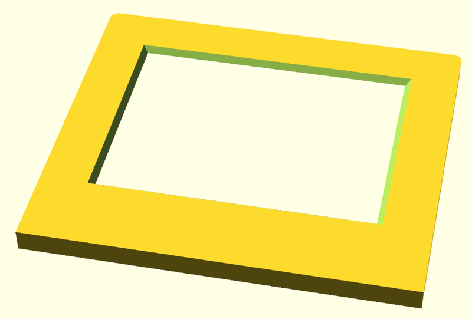
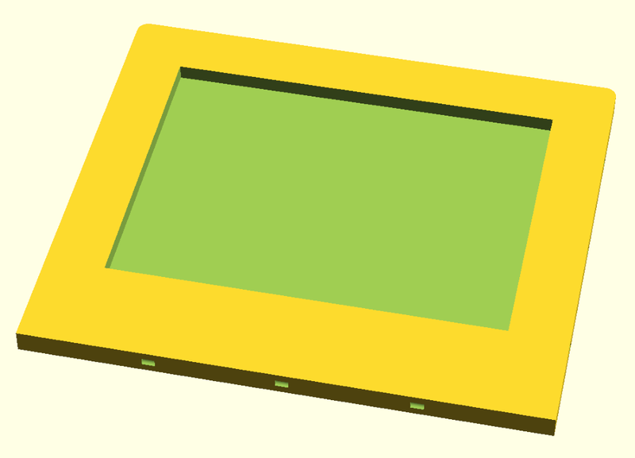

Generic Display Frame Library
=============================

This is a generic, configurable display frame library. It provides reusable
modules for integration into your own builds.

The core design principle is "**no screw - no glue**".

A display frame typically needs three parts:

  - a **back**: this part (module `display_back()`) provides the case/pocket
    for the display. This module needs a display specific mask for the
    cutouts that are necessary for plugs, SMD components and so on.
    
  - a **front**: The front (module `display_front()`) provides the beezel
    (passpartout) for the display. Depending on the display, an additional
    mask e.g. for buttons might be necessary
    
  - a **base** or a **frame**: the first option (module `display_base()`) is
    for table-top stands, the second option (module `display_frame()`) mimics
    the classical photo frames.
    
    

Requirements
------------

The system is implemented using SCAD. The only dependency is the BOSL2
library from <https://github.com/BelfrySCAD/BOSL2>.

Modules
-------

The target audience of the library are programmers with a basic understanding
of how OpenSCAD works. The library provides a number of core modules and additional
helper modules:

  - `dimensions.scad`: basic dimension constants. These are printer specific and
    might need adaption.
  - `display_parts.scad`: high-level modules
  - `frame_parts.scad`: helper modules for `display_frame()`
  - `joiners.scad`: helper modules for joiners

Currently, there is no need to use the helper modules directly.

Joiners and Wall-Locks
----------------------

It is possible to build both the back and the front with dove-tail
joiners. This results in a compact and stable sandwich of back,
display and front:

An alternative are wall-locks. There are two use cases: either the
front has a *wall*:

or the front and back are used together with a frame:

In the first case the back locks into the front, in the second case the
back locks into the frame.

Frames
------

The frame can be printed without supports:

In this case, create the back without joiners (`jlock=false`) and add
wall-locks (`wall_locks=<size>`). The front needs to have chamfers:

    display_front(..., chamfer=true, ...);
    display_back(..., jlock=false, wall_lock=W2, ...);
    display_frame(..., wall_lock=W2, ...);

In this example `W2` is the size of a wall with two perimeters. It is defined
in `dimensions.scad`.

Builds
------

Besides the basic library modules there are ready-made "builds" for a
set of displays:

  - [Pimoroni Inky-Impression 4" (first generation ACEP version)](inky-impression-4-acep/Readme.md)
  - [Pimoroni Inky-Impression 7.3" (second generation Spectra6 version)](inky-impression-7-spectra6/Readme.md)
  - [Waveshare Pico-ResTouch-LCD-2.8"](ws-pico-restouch-lcd-2.8/Readme.md)

License
-------

[![CC BY-SA 4.0][cc-by-sa-shield]][cc-by-sa]

This work is licensed under a
[Creative Commons Attribution-ShareAlike 4.0 International
License][cc-by-sa].

[![CC BY-SA 4.0][cc-by-sa-image]][cc-by-sa]

[cc-by-sa]: http://creativecommons.org/licenses/by-sa/4.0/
[cc-by-sa-image]: https://licensebuttons.net/l/by-sa/4.0/88x31.png
[cc-by-sa-shield]:
https://img.shields.io/badge/License-CC%20BY--SA%204.0-lightgrey.svg
